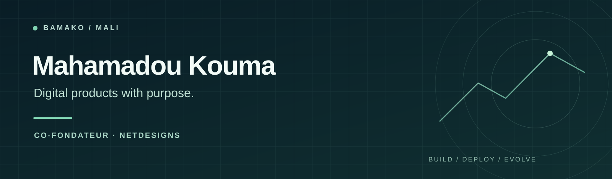

  

<h1 align="center">Bonjour, moi c’est Mahamadou.</h1>

  <strong>Entrepreneur du numérique · Co-fondateur de Netdesigns</strong> 
  Je transforme des besoins métier en produits numériques utiles, clairs et durables.

  <a href="https://netdesigns.fr/">Netdesigns</a> &nbsp;·&nbsp;
  <a href="https://netdesigns.fr/logiciels-mali">Nos logiciels</a> &nbsp;·&nbsp;
  <a href="https://www.linkedin.com/in/mahamadou-kouma-04426b115/">LinkedIn</a> &nbsp;·&nbsp;
  <a href="mailto:contact@netdesigns.fr">Me contacter</a>

---

### Des idées aux outils qui servent vraiment

Basé à **Bamako**, je travaille avec l’équipe Netdesigns à concevoir et déployer des solutions adaptées aux réalités des entreprises au Mali et en Afrique de l’Ouest : logiciels métier, applications, sites web et automatisations.

Je m’intéresse autant à la qualité de l’expérience qu’à ce qui la rend fiable : des données bien structurées, des accès maîtrisés et des outils que les équipes peuvent utiliser dans la durée.

> **Build for people. Design for clarity. Make it last.**

### Ce que nous construisons

- **Logiciels métier** — gestion commerciale, ventes, stocks, facturation et opérations terrain.
- **Produits web et mobiles** — interfaces accessibles, pensées pour les usages réels.
- **Automatisation & intégrations** — des processus plus fluides et moins de tâches répétitives.
- **Déploiement & accompagnement** — de la mise en production à la transmission aux équipes.

### Quelques produits de l’écosystème Netdesigns

| Produit | À quoi il sert |
| :--- | :--- |
| [**MarketPro**](https://netdesigns.fr/saas/marketpro) | Point de vente et gestion pour les commerces. |
| [**GestionPro**](https://netdesigns.fr/saas/gestionpro) | Gestion des ventes, factures, stocks et activité des entreprises. |
| [**ClinicPro**](https://netdesigns.fr/saas/clinicpro) | Outils de gestion pour les cliniques et établissements de santé. |
| [**Malited**](https://malited.com/) | Plateforme de petites annonces et de mise en relation. |

Ces produits sont présentés comme des réalisations de l’équipe Netdesigns. Découvrez aussi notre [catalogue de logiciels](https://netdesigns.fr/logiciels-mali) et nos [réalisations](https://netdesigns.fr/portfolio).

### Ma façon de travailler

**Comprendre le terrain** → **concevoir avec clarté** → **livrer et accompagner**

Partir du quotidien des utilisateurs, poser les bonnes questions, construire par étapes et garder une attention constante à la fiabilité comme à la simplicité.

---

  <strong>Vous avez une idée ou un défi métier ? Parlons-en.</strong> 
  <a href="mailto:contact@netdesigns.fr">contact@netdesigns.fr</a> &nbsp;·&nbsp;
  <a href="https://netdesigns.fr/">netdesigns.fr</a> &nbsp;·&nbsp;
  <a href="https://www.linkedin.com/in/mahamadou-kouma-04426b115/">LinkedIn</a>

Made in Bamako · Building useful digital products for businesses.

